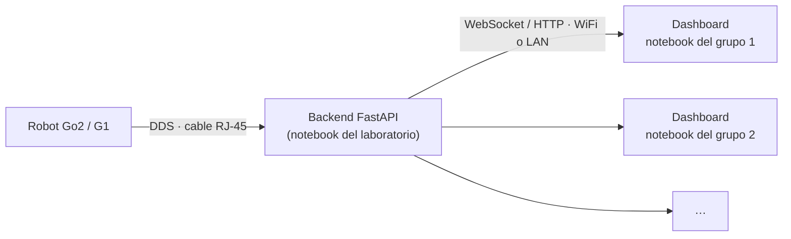
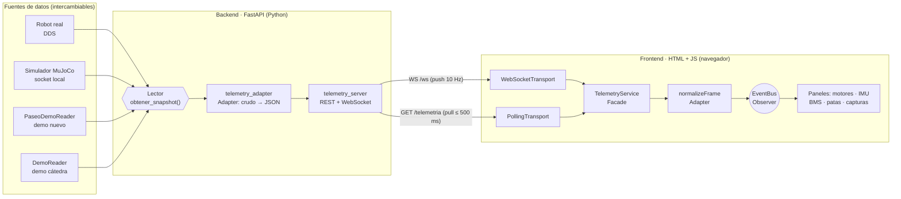
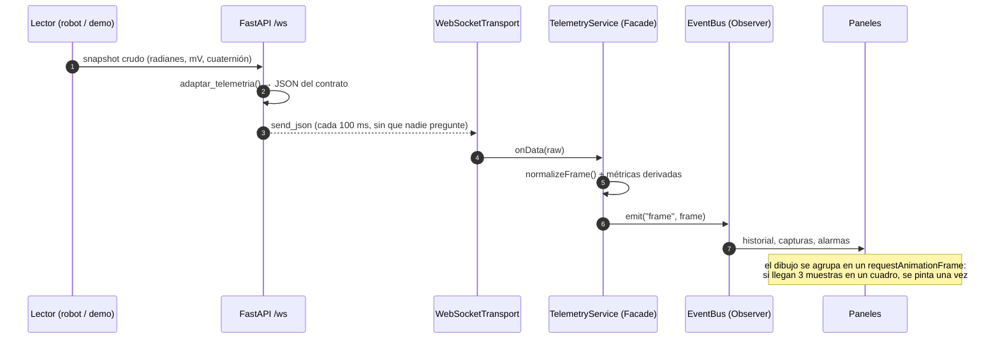

<div align="center">

# 🤖 Dashboard Web de Telemetría · Unitree Go2 / G1

**TP05 · Desarrollo de Aplicaciones II · UADE — Laboratorio de Robótica**

La versión web del monitor de motores **electroSim**: un backend en Python (FastAPI) expone la
telemetría del robot y un frontend en HTML/JS la visualiza **en vivo**, a 10 muestras por segundo,
por **WebSocket** o **polling**.

[](https://github.com/carlos-illobre/robot/actions/workflows/ci.yml)


<!-- CAPTURA PRINCIPAL: se agrega cuando esté elegido el diseño final -->

[**Empezar en 1 minuto**](#-empezar-en-1-minuto) ·
[Instalación](#-instalación-paso-a-paso) ·
[Guía de uso](#-guía-de-uso) ·
[Arquitectura](#-arquitectura) ·
[Patrones](#-patrones-de-diseño-aplicados) ·
[API](#-contrato-de-la-api) ·
[Pruebas](#-pruebas-y-calidad) ·
[Problemas frecuentes](#-problemas-frecuentes)

</div>

---

## 📑 Índice

1. [Qué es y por qué existe](#-qué-es-y-por-qué-existe)
2. [Empezar en 1 minuto](#-empezar-en-1-minuto)
3. [Cumplimiento de la consigna](#-cumplimiento-de-la-consigna)
4. [Instalación paso a paso](#-instalación-paso-a-paso)
5. [Guía de uso](#-guía-de-uso)
6. [Arquitectura](#-arquitectura)
7. [Patrones de diseño aplicados](#-patrones-de-diseño-aplicados)
8. [El modo demo "paseo": física de juguete, coherente](#-el-modo-demo-paseo-física-de-juguete-coherente)
9. [Contrato de la API](#-contrato-de-la-api)
10. [Formato del CSV exportado](#-formato-del-csv-exportado)
11. [Decisiones técnicas y sus porqués](#-decisiones-técnicas-y-sus-porqués)
12. [Pruebas y calidad](#-pruebas-y-calidad)
13. [Hallazgos: errores en el material de la cátedra](#-hallazgos-dos-errores-en-el-material-de-la-cátedra)
14. [Proceso de diseño de la interfaz](#-proceso-de-diseño-de-la-interfaz)
14. [Estructura del repositorio](#-estructura-del-repositorio)
15. [Problemas frecuentes](#-problemas-frecuentes)
16. [Roles del equipo y créditos](#-roles-del-equipo-y-créditos)

---

## 🎯 Qué es y por qué existe

En robótica, la **telemetría** es la forma de saber qué le pasa al robot *mientras* se mueve:
qué motor calienta, cuánto esfuerzo hace cada articulación, hacia dónde está inclinado, cuánta
batería le queda y qué patas tiene apoyadas. La cátedra tiene una herramienta de escritorio para
eso, **electroSim** (Python + PyQt6). Este proyecto es **su versión web**.

La gracia no es solo "verlo en el navegador". Es la arquitectura que eso obliga a pensar:

```
 ┌───────────────┐   DDS / socket   ┌────────────────────┐   HTTP + WebSocket   ┌─────────────────────┐
 │ Robot real o  │ ───────────────► │  Backend FastAPI   │ ───────────────────► │  Dashboard web      │
 │ simulador     │                  │  (proveedor)       │   JSON normalizado   │  (visualizador)     │
 └───────────────┘                  └────────────────────┘                      └─────────────────────┘
      fuente                            interfaz de servicio                         presentación
```

- El **backend** es el *proveedor de datos*: habla con el robot y publica un contrato estable.
- El **frontend** es el *visualizador*: no sabe (ni le importa) si los datos vienen del robot, del
  simulador MuJoCo o de un generador demo.
- El **contrato** (`docs/API.md`) es lo único que los une. Por eso, el día de la visita al
  laboratorio, **el mismo dashboard se conecta al robot real cambiando solo la IP**.

---

## ⚡ Empezar en 1 minuto

> Requisito único: **Python 3.10 o superior**. No hace falta el robot, ni MuJoCo, ni Node, ni
> internet (después de instalar las dependencias).

Un solo comando, **igual en Windows, macOS y Linux**:

```bash
python iniciar.py
```

(En Windows también funciona `py iniciar.py`, o doble clic en `iniciar.py` si Python está asociado
a los archivos `.py`; en macOS/Linux puede hacer falta `python3`.)

El script —escrito en Python, sin `.sh` ni `.bat`, para que no haya diferencias entre sistemas—
crea un entorno virtual (`.venv`), instala las dependencias **solo la primera vez**, levanta el
backend en **modo demo** (el robot "pasea" solo) y abre el navegador en
**http://localhost:8001** recién cuando el servidor responde. Eso es todo.

| Variante | Comando |
|---|---|
| Humanoide G1 (29 motores) | `python iniciar.py --robot g1` |
| Robot real (laboratorio) | `python iniciar.py --real --interfaz eth0` |
| Otro puerto | `python iniciar.py --puerto 8002` |
| Sin abrir el navegador | `python iniciar.py --sin-navegador` |

> 💡 **Para el día de la presentación:** corré `python iniciar.py` una vez antes, con internet.
> A partir de ahí arranca sin conexión (fuentes, Chart.js y Three.js están incluidos en el repo).

¿Preferís hacerlo a mano? Son tres comandos:

```bash
python -m pip install -r requirements.txt
```

```bash
python backend/servidor.py --demo
```

```text
Abrir http://localhost:8001 en el navegador
```

---

## ✅ Cumplimiento de la consigna

Cada requisito del enunciado ([`docs/consigna.md`](docs/consigna.md)) y dónde está resuelto.

| Requisito | Estado | Dónde / cómo |
|---|:---:|---|
| Levantar el servidor FastAPI de la cátedra y verificar los endpoints | ✅ | `backend/api/telemetry_server.py` sin modificar; `backend/tests/test_api.py` prueba **todos** los endpoints y el WebSocket con Go2 y G1 |
| **Panel de motores**: temperatura con semáforo (verde < 40 °C, amarillo 40–60 °C, rojo > 60 °C), ángulo, velocidad, torque | ✅ | `tempLevel()` en `frontend/js/core/telemetryModel.js` (umbrales idénticos a electroSim, con prueba unitaria de los bordes 40 y 60) |
| 12 motores para Go2, **29 para G1** | ✅ | El dashboard se arma con `GET /info` ("consultá /info en vez de asumir"); `python backend/servidor.py --demo --robot g1` |
| **Panel IMU**: roll, pitch, yaw numéricos + gráfico histórico de **≥ 60 muestras** | ✅ | Ventana configurable de 60, 150 o 300 muestras; historial en un buffer circular de 600 |
| **Panel BMS**: carga (%), corriente (mA), temperatura, voltajes de celda | ✅ | Además: tensión de pack, potencia y desbalance entre celdas (Δ mV) |
| **Panel de patas**: contacto FR, FL, RR, RL | ✅ | Vista superior del robot + diagrama de marcha (qué pata apoya en cada instante) |
| Actualización automática: polling a `/telemetria` (**≤ 500 ms**) **o** WebSocket | ✅ | Los dos, intercambiables en caliente. Polling de 100/250/500 ms (tope forzado en el código: `MAX_POLL_INTERVAL_MS = 500`) |
| Botón **Capturar muestra** | ✅ | Botón + tecla <kbd>C</kbd>; además **grabación continua** (<kbd>R</kbd>) |
| Botón **Exportar CSV** con todas las capturas | ✅ | Botón + tecla <kbd>E</kbd>; formato estándar o "Excel en castellano" (`;` y coma decimal) |
| Funciona en **modo demo** del servidor | ✅ | Tres fuentes: demo "paseo" (nuevo), demo original de la cátedra y simulador MuJoCo |
| *Extensión*: reemplazar polling por **WebSocket** | ✅ | `WebSocketTransport.js`, con reconexión automática (backoff exponencial con jitter) |
| *Objetivo general*: patrones **Adapter, Observer, Facade** | ✅ | Ver [Patrones de diseño aplicados](#-patrones-de-diseño-aplicados) (más Strategy y Factory Method) |

**Extras que no pedía la consigna:** alarmas de temperatura, torque y batería con historial de
eventos · tema claro y oscuro · atajos de teclado · diseño adaptable a celular · funciona sin
internet (Chart.js incluido en el repo) · pruebas automáticas en Python y JavaScript con CI en
GitHub Actions · scripts de arranque en un paso · visor de maquetas publicado en GitHub Pages.

---

## 🛠 Instalación paso a paso

### Requisitos

| Qué | Versión | Para qué | ¿Obligatorio? |
|---|---|---|:---:|
| [Python](https://www.python.org/downloads/) | 3.10 o superior | Backend FastAPI | ✅ |
| Navegador moderno | Chrome, Edge o Firefox actuales | Dashboard | ✅ |
| [Node.js](https://nodejs.org/) | 18 o superior | Solo para **desarrollar**: pruebas del frontend y E2E, y la conversión de los modelos 3D | ➖ |
| [Git](https://git-scm.com/) | cualquiera | Clonar el repositorio (o bajar el ZIP) | ➖ |

> **Para usar el dashboard alcanza con Python y un navegador.** El frontend es JavaScript que
> ejecuta el navegador tal cual (sin compilar ni empaquetar), así que Node no es necesario para
> correr el proyecto: solo para las herramientas de desarrollo.

### 1. Obtener el código

```bash
git clone https://github.com/carlos-illobre/robot.git
```

```bash
cd robot
```

(o en GitHub: **Code → Download ZIP** y descomprimir).

### 2. Crear un entorno virtual (recomendado)

Un entorno virtual aísla las dependencias del proyecto de las del sistema.

<details open>
<summary><b>Linux / macOS</b></summary>

```bash
python3 -m venv .venv
```

```bash
source .venv/bin/activate
```

</details>

<details>
<summary><b>Windows (PowerShell)</b></summary>

```powershell
py -3 -m venv .venv
```

```powershell
.venv\Scripts\Activate.ps1
```

> Si PowerShell bloquea el script de activación:
> `Set-ExecutionPolicy -Scope CurrentUser RemoteSigned` y volver a intentar.

</details>

<details>
<summary><b>Windows (cmd)</b></summary>

```bat
py -3 -m venv .venv
```

```bat
.venv\Scripts\activate.bat
```

</details>

### 3. Instalar dependencias

```bash
python -m pip install -r requirements.txt
```

Instala `fastapi` y `uvicorn` (el servidor) y `pytest` + `httpx` (las pruebas). Nada más.

### 4. Levantar el backend

```bash
python backend/servidor.py --demo
```

Vas a ver:

```text
==================================================================
  BACKEND DE TELEMETRIA TP05 LISTO
==================================================================
  Robot : go2   Modo: demo

  DASHBOARD  ->  http://localhost:8001
  (desde otra maquina de la red: http://192.168.0.23:8001)
  ...
  Documentacion OpenAPI: http://localhost:8001/docs
==================================================================
```

### 5. Abrir el dashboard

Entrar a **http://localhost:8001**. El backend sirve el dashboard en `/dashboard/` y redirige la
raíz hacia ahí: un solo proceso, un solo puerto, cero problemas de CORS.

### 6. Verificar que todo anda

| Comprobación | Cómo | Resultado esperado |
|---|---|---|
| El backend responde | abrir http://localhost:8001/telemetria | un JSON con `motores`, `imu`, `bms`, `fuerzas` |
| La documentación viva | abrir http://localhost:8001/docs | Swagger UI con todos los endpoints |
| El dashboard recibe datos | mirar el indicador de conexión | **En vivo · WebSocket · ~10 Hz** |
| Las pruebas pasan | `python -m pytest backend/tests -q` y `npm test` | todo en verde |

---

## 📖 Guía de uso

### Elegir la fuente de datos

El backend es siempre el mismo; lo que cambia es **de dónde lee**. El dashboard no se entera.

| Comando | Fuente | Cuándo usarlo |
|---|---|---|
| `python backend/servidor.py --demo` | **Paseo simulado** (Go2) | Desarrollo, corrección, presentación. **Recomendado** |
| `python backend/servidor.py --demo --robot g1` | Paseo simulado (G1, 29 motores) | Ver el dashboard con el humanoide |
| `python backend/servidor.py --demo-catedra` | `DemoReader` original de la cátedra | Comparar con el demo provisto |
| `python backend/servidor.py` | Simulador MuJoCo de la cátedra (socket local) | Con el entorno `UadeRobotLab/TP05` corriendo |
| `python backend/servidor.py --real --interfaz eth0` | **Robot real** por DDS | En el laboratorio, con la notebook conectada al robot por cable |

Opciones del servidor:

| Opción | Por defecto | Descripción |
|---|---|---|
| `--robot {go2,g1}` | `go2` | Robot a simular / leer |
| `--puerto N` | `8001` | Puerto HTTP y WebSocket |
| `--host IP` | `0.0.0.0` | Interfaz donde escuchar (`127.0.0.1` para que no se vea en la red) |
| `--demo` | — | Paseo simulado sin MuJoCo |
| `--demo-catedra` | — | Demo original de la cátedra |
| `--real` | — | Robot real por DDS (necesita `unitree_sdk2py`) |
| `--interfaz NOMBRE` | automática | Placa de red conectada al robot (`eth0`, `enp3s0`…), solo con `--real` |
| `--fuente-fija` | — | No permitir cambiar la fuente desde el dashboard |

### 🔀 Elegir la fuente de datos desde el dashboard

La etiqueta junto al nombre del robot (arriba a la izquierda) dice siempre **de dónde vienen los
datos**: `REAL` en verde (medidos) o `SIMULADO` en violeta. Haciendo clic se abre el selector:

| Fuente | Qué es | Requisito |
|---|---|---|
| **Robot real** | El backend lee el robot por DDS | Notebook con cable al robot y `unitree_sdk2py` |
| **Simulador MuJoCo** | El simulador 3D de la cátedra | Simulador de la cátedra abierto en la máquina del backend |
| **Demo «paseo»** | Simulación coherente del backend | Nada |
| **Demo de la cátedra** | El `DemoReader` original | Nada |
| **Simulación en el navegador** | Los datos se generan en la página, sin servidor | Nada (es lo que usa GitHub Pages) |

…y el robot: **Go2** (12 motores) o **G1** (29). El cambio es **en caliente** (sin reiniciar nada) y
**transaccional**: el backend solo cambia si la fuente nueva entrega datos en 5 s; si no, sigue con
la anterior y el dashboard muestra el motivo. Las fuentes que no están disponibles aparecen grises
con la razón (por ejemplo: *«Falta el SDK de Unitree en la máquina del backend»*).

Por detrás son dos rutas que agrega `backend/fuentes.py` sin modificar la API de la cátedra:
`GET /fuentes` y `POST /fuente`. Como el cambio afecta a **todos** los dashboards conectados a ese
servidor, el día de la visita se puede bloquear con `--fuente-fija`.

### 🤖 Usar el dashboard con el robot real

El dashboard **no cambia nada** para el robot real: lo único distinto es de dónde lee el backend.
Hay dos escenarios, según quién levante el backend en el laboratorio:



**A. El backend de la cátedra ya está corriendo** (lo habitual en la visita). La cátedra levanta su
backend en la notebook conectada al robot y anuncia su IP. Cada grupo solo apunta su dashboard ahí:

```bash
python backend/servidor.py --demo
```

y en el navegador: `http://localhost:8001/?server=http://IP-DEL-BACKEND:8001` (o escribir la
dirección en el panel de conexión, haciendo clic en el indicador de estado). Como la API es de solo
lectura, **todos los grupos pueden conectarse a la vez**.

**B. Levantar este mismo backend contra el robot** (en la notebook conectada por cable):

1. Instalar el SDK de Unitree (incluye CycloneDDS):
   ```bash
   python -m pip install git+https://github.com/unitreerobotics/unitree_sdk2_python.git
   ```
2. Averiguar la placa de red conectada al robot (`ip -br addr` en Linux; la que tiene una IP de la
   red del robot, normalmente `192.168.123.x`).
3. Levantar el backend:
   ```bash
   python backend/servidor.py --real --robot go2 --interfaz eth0
   ```
4. Abrir `http://localhost:8001`. Las demás notebooks se conectan con la IP que imprime la consola.

> ⚠️ Con el robot real los números son **medidos**, no simulados: las temperaturas, los torques y
> las fuerzas van a ser otros. Los umbrales del semáforo son los de electroSim; el de alarma de
> torque se puede ajustar en la vista Consola.

### Conectar el dashboard a otro servidor

Tres formas, de la más cómoda a la más manual:

1. **Desde la URL**: `http://localhost:8001/?server=http://10.0.0.5:8001` — ideal para dejarlo
   como marcador el día de la visita.
2. **Desde la barra de conexión** del dashboard: escribir la dirección y presionar *Conectar*.
   Se recuerda para la próxima vez.
3. Si el dashboard se abre desde el mismo backend, usa automáticamente ese servidor.

También se puede forzar el transporte: `?transport=polling` o `?transport=websocket`.

<!-- GUÍA DE CADA PANEL, ATAJOS Y CAPTURAS: se completa con el diseño final elegido -->

### Capturar y exportar

| Acción | Botón | Tecla | Qué hace |
|---|---|:---:|---|
| Capturar muestra | **Capturar** | <kbd>C</kbd> | Congela una copia completa del estado actual del robot |
| Grabar | **Grabar** | <kbd>R</kbd> | Captura **todas** las muestras que llegan hasta que se vuelve a presionar |
| Exportar | **Exportar CSV** | <kbd>E</kbd> | Descarga `telemetria_<robot>_<fecha>_<hora>.csv` con todas las capturas |

> 💡 **Excel en castellano** usa `;` como separador y `,` como decimal. Activando la opción
> *Formato Excel* el CSV se abre con doble clic sin pasar por "Datos → Desde texto".

---

## 🏛 Arquitectura

### Vista de componentes



### Qué pasa con cada muestra (WebSocket)



### Del lado del cliente, en capas

| Capa | Archivos | Responsabilidad | Sabe de… |
|---|---|---|---|
| **Servicios** | `js/services/` | Hablar con el backend: REST, WebSocket, polling, reconexión | HTTP, WebSocket |
| **Núcleo** | `js/core/` | Modelo de datos, historial, capturas, CSV, alarmas. **Sin DOM** → testeable en Node | solo datos |
| **UI** | `js/ui/`, `js/panels/` | Dibujar. Cada panel recibe la muestra normalizada y el historial | DOM, Chart.js |
| **Composición** | `js/main.js` | Crear todo y conectarlo (único lugar que conoce a todos) | todo |

---

## 🧩 Patrones de diseño aplicados

La consigna pide **Adapter, Observer y Facade** para desacoplar la fuente de datos de la
presentación. Están los tres, y dos más que aparecieron naturalmente.

### 🔌 Adapter — traducir formatos sin contaminar el resto

**Problema:** el robot habla en radianes, milivoltios y cuaterniones, con nombres de campos del SDK
de Unitree (`q`, `dq`, `tau_est`, `cell_vol`). La UI quiere grados, voltios y roll/pitch/yaw.

Aparece **dos veces**, una a cada lado del contrato:

- **Backend** — `backend/api/telemetry_adapter.py` (de la cátedra) traduce el *snapshot* crudo al
  JSON de `docs/API.md`.
- **Frontend** — `normalizeFrame()` en `frontend/js/core/telemetryModel.js` no confía ciegamente
  en el servidor: garantiza tipos, completa faltantes y calcula una sola vez las métricas que
  comparten varios paneles (motor más caliente, patas apoyadas, desbalance de celdas…).

```js
// frontend/js/core/telemetryModel.js
export function normalizeFrame(raw, receivedAt = Date.now()) {
  const motores = (Array.isArray(raw.motores) ? raw.motores : []).map((m, i) => ({
    id: num(m?.id, i),
    nombre: String(m?.nombre ?? `motor_${i}`),
    temperatura: num(m?.temperatura),   // "45.5" → 45.5 ; null → 0
    /* … */
  }));
  /* … */
  frame.derived = deriveMetrics(frame); // tempMax, contacts, cellDeltaMv, isMoving…
  return frame;
}
```

Y el **`PaseoDemoReader`** es un adaptador en sentido amplio: implementa la misma interfaz que el
lector DDS del robot (`obtener_snapshot()`, `esperar_primer_dato()`, `mensajes_leidos`,
`cerrar()`), así que el servidor lo usa sin saber que es una simulación (principio de sustitución
de Liskov).

### 📣 Observer — quien produce no conoce a quien consume

**Problema:** cuando llega una muestra la tienen que enterar los paneles, el historial, el grabador
de capturas y las alarmas. Si el transporte llamara a cada uno, cada panel nuevo obligaría a tocar
el código de red.

`frontend/js/core/EventBus.js` es un publicador/suscriptor de 30 líneas:

```js
bus.on("frame", (frame) => history.push(frame));       // historial
bus.on("frame", (frame) => recorder.maybeCapture(frame)); // grabación continua
bus.on("connection", ({ state }) => statusPill.render(state));

bus.emit("frame", frame); // el transporte solo hace esto
```

Detalle de robustez: si un suscriptor lanza una excepción, **los demás igual se ejecutan** (hay
prueba unitaria para eso). Un panel con un bug no deja al resto del dashboard sin datos.

### 🚪 Facade — una sola puerta al backend

**Problema:** conectarse implica consultar `/info`, elegir transporte, crearlo, reconectar,
normalizar, medir frecuencia y detectar si el servidor dejó de mandar datos.

`frontend/js/services/TelemetryService.js` esconde todo eso detrás de tres métodos:

```js
const service = new TelemetryService(bus);
await service.connect({ baseUrl: "http://10.0.0.5:8001", transport: "websocket" });
service.setTransport("polling", 250);   // cambiar en caliente
service.disconnect();
```

Los paneles **nunca** llaman a `fetch` ni a `new WebSocket`.

### ♟ Strategy — WebSocket o polling, intercambiables

`WebSocketTransport` y `PollingTransport` exponen la misma interfaz (`start()`, `stop()`, y
avisan por `onData` / `onState`). El servicio elige uno en tiempo de ejecución:

```js
const TRANSPORTS = { websocket: WebSocketTransport, polling: PollingTransport };
const Transport = TRANSPORTS[this.options.transport];
this.#transport = new Transport({ baseUrl, intervalMs, onData, onState });
```

### 🏭 Factory Method — del lado del servidor

`crear_lector(modo, robot)` en `backend/servidor.py` decide qué fuente de datos se inyecta
(demo paseo, demo cátedra, simulador). El resto del backend recibe "un lector" y listo: es
**inyección de dependencias** con `configurar(lector, modelo, modo)`.

---

## 🦿 El modo demo "paseo": física de juguete, coherente

El `DemoReader` original de la cátedra genera senoidales independientes. Sirve para ver que el
dashboard dibuja, pero tiene dos problemas para evaluar un dashboard:

- la temperatura nunca pasa de ~43 °C, así que **el semáforo jamás se pone rojo**;
- las patas apoyan al azar, sin una marcha reconocible.

`backend/api/demo_paseo.py` reproduce lo que hace el simulador MuJoCo de la cátedra (el robot
"se pasea solo"), pero sin MuJoCo y con **relaciones causales** entre los datos:

```
guion del paseo ──► velocidad del robot ──► amplitud de la marcha ──► ángulo y velocidad de cada motor
                                       └──► esfuerzo ──► torque ──► temperatura (modelo térmico)
                                                              └──► corriente ──► batería y celdas
fase de la marcha ──► qué patas apoyan ──► fuerzas
giro ──► yaw (integrado)         oscilación de la marcha ──► roll / pitch
```

**El guion**: quieto 6 s → camina 10 s → curva 5 s → trota 12 s → gira 4 s → quieto 7 s →
camina rápido 14 s → quieto 5 s → vuelve a empezar. Corto y variado a propósito: con tramos
largos los gráficos se ven planos.

**La marcha (Go2)**: trote, con las patas diagonales en fase (FR+RL y FL+RR) y los dos pares en
contrafase. Por eso en el diagrama de patas se ve la "X" característica del trote.

**El modelo térmico** es la ley de enfriamiento de Newton con una fuente de calor por efecto
Joule (el torque es proporcional a la corriente y las pérdidas, a la corriente al cuadrado):

$$
\frac{dT}{dt} = k_{calor}\left(\frac{\tau}{\tau_{nominal}}\right)^2 - \frac{T - T_{ambiente}}{\tau_{térmica}}
$$

Se integra con Euler a 50 Hz en un hilo propio. Las pantorrillas (que cargan el peso) calientan
más y pasan los 60 °C después de trotar un rato; las caderas casi no se mueven del verde. **Los
tres colores del semáforo aparecen solos**, y hay una prueba automática que lo verifica.

> ⚠️ Igual que el simulador de la cátedra, estos valores son **coherentes pero no medidos**.
> Contra el robot real los números serán otros: los umbrales de alarma son configurables.

---

## 📡 Contrato de la API

Base: `http://<IP>:8001` · Documentación interactiva: `http://<IP>:8001/docs` · **Solo lectura**:
no existe ningún endpoint que mueva el robot.

| Método | Ruta | Devuelve |
|---|---|---|
| `GET` | `/telemetria` | todo junto: motores, IMU, batería, patas |
| `GET` | `/motores` | solo los motores |
| `GET` | `/imu` | solo la inclinación |
| `GET` | `/bms` | solo la batería |
| `GET` | `/fuerzas` | qué patas están apoyadas |
| `GET` | `/info` | nombre y tipo del robot, cantidad y nombres de motores, patas, modo |
| `WS` | `/ws` | el mismo JSON que `/telemetria`, empujado ~10 veces por segundo |

```json
{
  "modelo": "go2",
  "ts": 16.24,
  "motores": [
    { "id": 0, "nombre": "FR_hip", "angulo": 45.84, "velocidad": -0.218, "torque": 1.31, "temperatura": 30.0 }
  ],
  "imu":     { "roll": -1.39, "pitch": -1.06, "yaw": 78.2, "ax": -0.043, "ay": -0.012, "az": 9.79 },
  "bms":     { "soc": 86, "corriente": 1450, "temperatura": 31.2, "celdas": [4.05, 4.06, 4.04] },
  "fuerzas": { "FR": 1, "FL": 0, "RR": 0, "RL": 1 }
}
```

| Campo | Unidad | | Campo | Unidad |
|---|---|---|---|---|
| `angulo` | grados | | `roll` `pitch` `yaw` | grados |
| `velocidad` | rad/s | | `soc` | % |
| `torque` | N·m | | `corriente` | mA |
| `temperatura` | °C | | `celdas` | V |
| `ts` | s desde que arrancó el servidor | | `fuerzas` | 1 = apoyada, 0 = en el aire |

Errores: `400` (modelo inválido), `409` (se pidió un robot distinto del conectado), `503` (todavía
no llegó telemetría). El contrato completo de la cátedra está en [`docs/API.md`](docs/API.md).

---

## 📄 Formato del CSV exportado

Formato **ancho**: una fila por muestra, una columna por variable. Es lo que esperan Excel,
LibreOffice, pandas o MATLAB sin transformar nada.

| Columnas | Ejemplo |
|---|---|
| Identificación | `captura`, `tipo` (manual / continua), `fecha_hora_iso`, `ts_servidor_s`, `modelo` |
| IMU | `imu_roll_deg`, `imu_pitch_deg`, `imu_yaw_deg`, `imu_ax_ms2`, `imu_ay_ms2`, `imu_az_ms2` |
| Batería | `bms_soc_pct`, `bms_corriente_mA`, `bms_temperatura_C`, `bms_celda_1_V` … `bms_celda_N_V` |
| Patas | `pata_FR_contacto`, `pata_FL_contacto`, `pata_RR_contacto`, `pata_RL_contacto` |
| Por motor (×12 o ×29) | `FR_hip_angulo_deg`, `FR_hip_velocidad_rads`, `FR_hip_torque_Nm`, `FR_hip_temperatura_C`, … |

Detalles cuidados: las unidades van en el nombre de la columna; los campos se escapan según
**RFC 4180**; el archivo lleva **BOM UTF-8** para que Excel muestre bien los acentos; las columnas
se generan a partir de los datos (no hay 12 motores "hardcodeados").

Ejemplo de análisis rápido con pandas:

```python
import pandas as pd
df = pd.read_csv("telemetria_go2_2026-10-29_17-30-05.csv")
df.filter(like="_temperatura_C").max().sort_values(ascending=False).head(3)  # los 3 motores más calientes
```

---

## 🔎 Hallazgos: dos errores en el material de la cátedra

Al mover el **modelo 3D oficial de Unitree** con la telemetría (vista Gemelo 3D) aparecieron dos
inconsistencias en el código provisto. El modo demo las ocultaba porque genera cada ángulo **por
nombre**; con datos reales o del simulador saltan a la vista.

| # | Qué | Evidencia (repositorio de la cátedra, `TP05/entorno/`) | Efecto | Corrección en este repo |
|---|---|---|---|---|
| 1 | **G1: los nombres de la cadera están invertidos.** `config.py` dice `hip_yaw, hip_roll, hip_pitch`; el orden real es `hip_pitch, hip_roll, hip_yaw` | `api/config.py:44` vs. actuadores de `sim/unitree_mujoco/unitree_robots/g1/g1_29dof.xml:387-399` y `sim/robots.py:115` (`G1_L_HIP_P = 0`) | Con el G1 real o el simulador, el dato rotulado *guiñada* de cadera es el *cabeceo* y viceversa (6 de 29 motores) | `backend/api/config.py` corregido, con comentario; prueba `test_g1_nombra_la_cadera_en_el_orden_real_de_unitree` |
| 2 | **Go2 con el simulador: patas izquierda y derecha cruzadas.** El simulador publica `qpos` en el orden de cuerpos del modelo (FL, FR, RL, RR); el contrato es FR, FL, RR, RL | `sim/simulador.py:80,91` publica `qpos[7:]`; `go2.xml:78,112,147,182` declara FL, FR, RL, RR; `api/config.py:30` y los actuadores (`go2.xml:223`) usan FR, FL, RR, RL | Solo con el simulador: lo que se muestra como "delantera derecha" es la izquierda. **Con el robot real (DDS) no pasa** | Adapter `OrdenSimulador` en `backend/servidor.py` que reordena sin tocar el lector de la cátedra; prueba `test_simulador_go2_se_reordena_al_orden_del_sdk` |

> **Alcance:** verificado leyendo y cruzando los archivos (configuración, modelo oficial y código
> del simulador coinciden entre sí y contradicen a `config.py`). No se pudo probar con un G1 real
> ni con el simulador MuJoCo corriendo. Para confirmarlo en el laboratorio: con el G1 parado,
> mover a mano solo la cadera hacia adelante y ver qué motor cambia.
>
> Si el dashboard se usa contra el **backend original** de la cátedra (sin esta corrección), la
> vista Gemelo 3D acepta `?mapeo=indice` en la URL para mover el modelo por posición (orden del
> SDK) en vez de por nombre.

---

## 🧠 Decisiones técnicas y sus porqués

| Decisión | Alternativa descartada | Por qué |
|---|---|---|
| **JavaScript sin framework**, módulos ES nativos | React / Vue + Vite | El TP es sobre integrar componentes a través de una interfaz. Sin framework se ve todo el flujo; sin paso de compilación, cualquiera abre el código y lo entiende |
| **Chart.js incluido en el repo** (`frontend/vendor/`) | Cargarlo de un CDN | El laboratorio puede no tener internet. El dashboard funciona 100 % offline |
| El backend **sirve el frontend** (`/dashboard`) | Abrir `index.html` con doble clic | Los módulos ES no cargan desde `file://`, y así no hay CORS ni un segundo servidor |
| Polling con **`setTimeout` encadenado** | `setInterval` | Con `setInterval`, si el servidor tarda más que el intervalo las peticiones se apilan y llegan desordenadas |
| Reconexión con **backoff exponencial + jitter** | Reintentar cada 1 s | 30 dashboards reconectando en el mismo milisegundo saturan al servidor recién levantado |
| **Buffer circular** de 600 muestras | Un array que crece | A 10 Hz, una clase de 2 h son 72.000 muestras: memoria constante y `push` O(1) |
| Dibujo agrupado con **`requestAnimationFrame`** | Redibujar en cada mensaje | Si llegan varias muestras en un cuadro de pantalla se dibuja una sola vez; con la pestaña oculta no se dibuja |
| Gráficos con `animation: false` y `parsing: false` | Valores por defecto de Chart.js | A 10 Hz las animaciones solo agregan retraso visual; los datos ya llegan como `{x, y}` |
| Sparklines en `<canvas>` propio | Un Chart.js por fila | 29 instancias de Chart.js a 10 Hz es demasiado para una notebook del laboratorio |
| Lógica en `js/core/` **sin DOM** | Mezclar lógica y DOM | Se prueba en Node, sin navegador |

---

## 🧪 Pruebas y calidad

```bash
python -m pytest backend/tests -q
```

```bash
npm test
```

| Suite | Qué verifica |
|---|---|
| **Backend** (`backend/tests/test_api.py`, pytest) | Todos los endpoints y el WebSocket respetan el contrato, con **Go2 y G1** · errores 400/409 · el paseo recorre los **tres colores del semáforo** · con el robot quieto apoya las **cuatro patas** y al trotar no · el yaw cambia al girar |
| **Frontend** (`frontend/tests/core.test.js`, `node:test`, sin dependencias) | Bordes del semáforo (40 y 60 °C) · normalización tolerante a datos rotos · buffer circular · EventBus aísla errores · CSV (columnas, RFC 4180, formato Excel) · las alarmas solo avisan cambios · backoff de reconexión · URLs `http→ws` / `https→wss` |

**Integración continua:** cada push corre las dos suites en GitHub Actions
([`.github/workflows/ci.yml`](.github/workflows/ci.yml)).

---

## 🎨 Proceso de diseño de la interfaz

La interfaz no se diseñó "programando y viendo qué sale". Se usó un flujo de dos roles,
definido como *skill* y agente de Claude Code en [`.claude/`](.claude):

1. **Director de arte** ([`.claude/skills/art-director/`](.claude/skills/art-director)): sin ver el
   código, lee la consigna y el contrato de la API y propone **tres variantes muy distintas**
   (la evolución, la reinvención y la que nadie se animaría), para computadora y celular, con
   datos simulados en movimiento.
2. **Elección**: se comparan funcionando en el **visor de maquetas**, publicado en GitHub Pages:
   **https://carlos-illobre.github.io/robot/**
3. **Maquetador** ([`.claude/agents/mockup-builder.md`](.claude/agents/mockup-builder.md)): toma
   la variante elegida, la ajusta a la consigna y a la tecnología disponible, y deja el lenguaje
   visual documentado en `docs/design/visual-language.md`.
4. Recién entonces se lleva al dashboard real (`frontend/`).

<!-- VARIANTE ELEGIDA Y LENGUAJE VISUAL: se completa al elegir -->

---

## 🗂 Estructura del repositorio

```
robot/
├── iniciar.py                   ← arranque en un paso, multiplataforma (entorno + dependencias + navegador)
├── requirements.txt
├── backend/
│   ├── servidor.py              ← lanzador: elige la fuente de datos y sirve el dashboard
│   ├── api/
│   │   ├── telemetry_server.py  ← API REST + WebSocket (cátedra, sin modificar)
│   │   ├── telemetry_adapter.py ← crudo del robot → JSON del contrato (cátedra)
│   │   ├── telemetry_reader*.py ← lectores: simulador por socket, robot por DDS, demo (cátedra)
│   │   ├── demo_paseo.py        ← NUEVO: demo con marcha, modelo térmico y batería
│   │   └── config.py            ← robots, nombres de motores, puertos (cátedra)
│   └── tests/test_api.py
├── frontend/
│   ├── index.html
│   ├── css/
│   ├── js/
│   │   ├── main.js              ← raíz de composición
│   │   ├── config.js            ← preferencias y dirección del servidor
│   │   ├── core/                ← EventBus, RingBuffer, modelo, capturas, CSV, alarmas (sin DOM)
│   │   ├── services/            ← ApiClient, TelemetryService (Facade), transportes (Strategy)
│   │   ├── ui/                  ← helpers de DOM, íconos, tema, gráficos, avisos
│   │   └── panels/              ← un archivo por panel
│   ├── vendor/chart.umd.min.js  ← Chart.js 4.4.1 (licencia MIT), para funcionar sin internet
│   └── tests/core.test.js
├── docs/
│   ├── consigna.md              ← el enunciado
│   ├── API.md                   ← el contrato de la cátedra
│   └── design/                  ← visor de maquetas (GitHub Pages) y lenguaje visual
├── .claude/                     ← skill de director de arte y agente maquetador
└── .github/workflows/           ← CI (pruebas) y publicación del visor
```

---

## 🩺 Problemas frecuentes

<details>
<summary><b>"python no se reconoce como un comando" (Windows)</b></summary>

Python no está en el PATH. Reinstalarlo tildando **"Add python.exe to PATH"**, o usar el lanzador
`py`: `py -3 backend\servidor.py --demo`.
</details>

<details>
<summary><b>"Address already in use" / el puerto 8001 está ocupado</b></summary>

Otro proceso (quizás otro backend que quedó abierto) usa el puerto. Cerrarlo, o usar otro:
`python backend/servidor.py --demo --puerto 8002` y abrir `http://localhost:8002`.
</details>

<details>
<summary><b>El dashboard dice "Reconectando…" y no llegan datos</b></summary>

1. ¿Sigue abierta la ventana del backend? Si se cerró, volver a levantarlo: el dashboard
   **reconecta solo**, no hace falta recargar la página.
2. Abrir `http://<IP>:8001/telemetria` en el navegador. Si aparece el JSON, la dirección
   configurada en el dashboard es otra: corregirla en la barra de conexión.
3. En una red con proxy que bloquea WebSocket, cambiar a **Polling**.
</details>

<details>
<summary><b>Error de CORS en la consola</b></summary>

El backend permite cualquier origen, así que casi siempre es una **dirección equivocada** (otro
puerto, `https` en vez de `http`). Lo más simple: abrir el dashboard desde el propio backend
(`http://<IP>:8001`).
</details>

<details>
<summary><b>Abrí <code>frontend/index.html</code> con doble clic y no anda</b></summary>

Los navegadores no cargan módulos JavaScript desde `file://` por seguridad. Abrirlo desde el
backend (`http://localhost:8001`) o con cualquier servidor estático:
`python -m http.server -d frontend 5500` y luego `http://localhost:5500/?server=http://localhost:8001`.
</details>

<details>
<summary><b>Todos los gráficos están planos</b></summary>

El robot está quieto. En el demo "paseo" hay tramos quietos de 5 a 7 s: esperar unos segundos. Con
el simulador MuJoCo, verificar que no se haya arrancado con `--sin-paseo`.
</details>

<details>
<summary><b>Con el simulador MuJoCo: "No llegan datos del simulador"</b></summary>

`python backend/servidor.py` (sin `--demo`) lee del simulador de la cátedra por un socket local.
Primero hay que levantar ese simulador (`INICIAR_TP05` del repositorio de la cátedra). Para todo
lo demás alcanza con `--demo`.
</details>

---

## 👥 Roles del equipo y créditos

La consigna sugiere tres roles. Así se reparte este repositorio:

| Rol | Alcance en el código |
|---|---|
| **Backend** | `backend/` — servidor FastAPI, modo demo "paseo", lanzador, pruebas de la API |
| **Frontend** | `frontend/css`, `frontend/js/ui`, `frontend/js/panels` — paneles, gráficos, diseño |
| **Integración y CSV** | `frontend/js/services`, `frontend/js/core` — transportes, Facade, capturas, exportación |

**Créditos**

- Backend de telemetría, contrato de la API y simulador: cátedra de Desarrollo de Aplicaciones II
  (UADE), repositorio [`tsamaan/UadeRobotLab`](https://github.com/tsamaan/UadeRobotLab/tree/main/05LaboratoriosTPs/TP05_Desarrollo_de_Aplicaciones_II).
- [Chart.js](https://www.chartjs.org/) 4.4.1 — licencia MIT (`frontend/vendor/CHARTJS-LICENSE.md`).
- Íconos con trazos estilo [Lucide](https://lucide.dev/) — licencia ISC.
- Robots [Unitree](https://www.unitree.com/) Go2 y G1.
