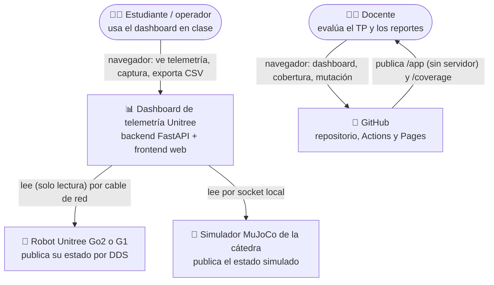
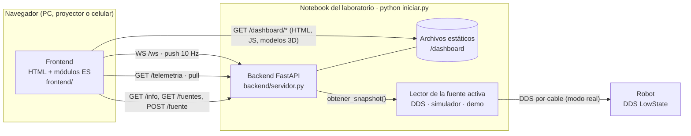
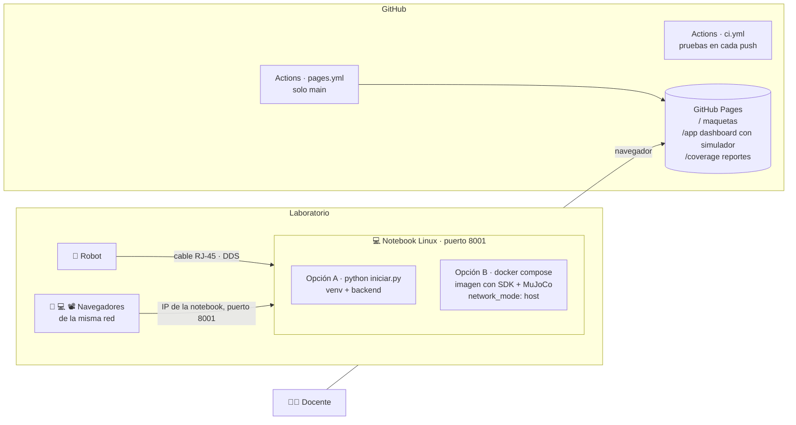
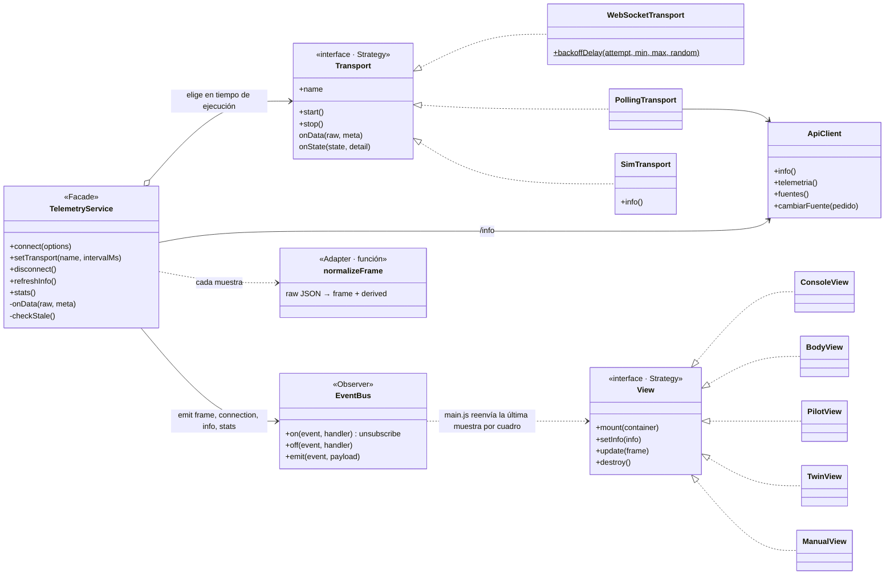
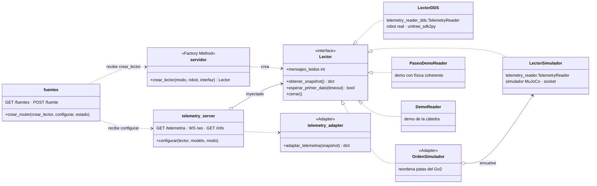
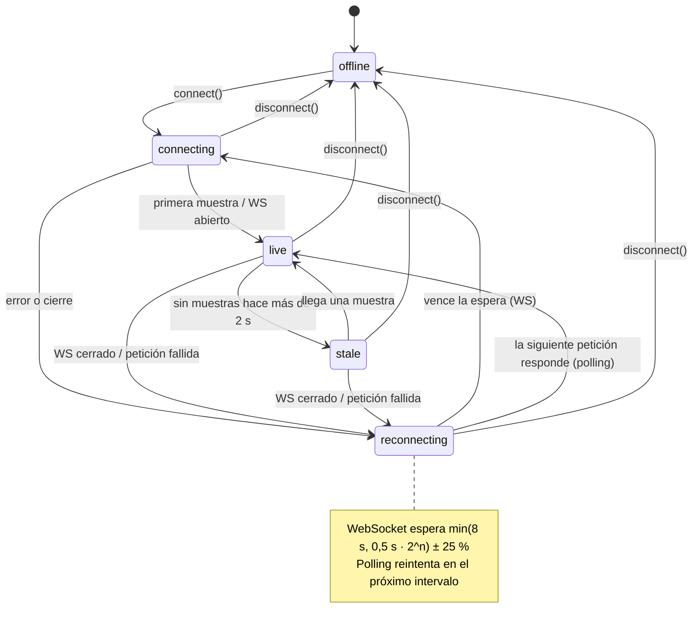
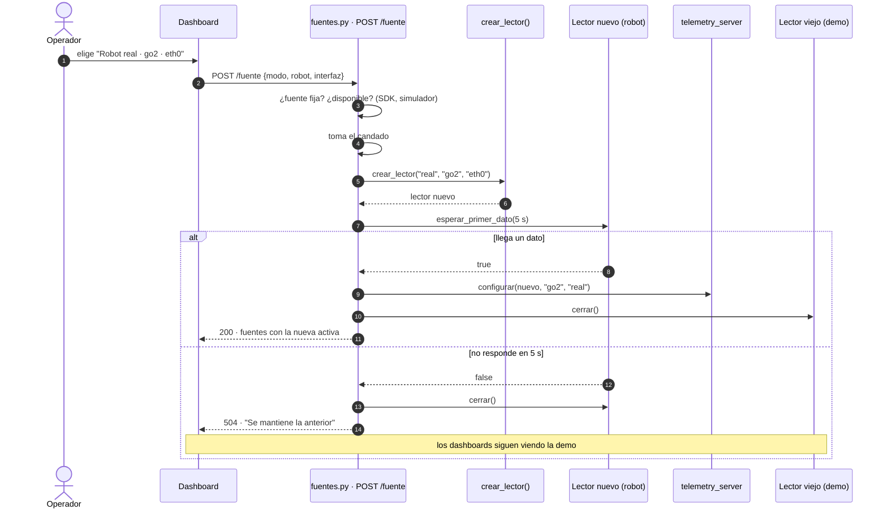
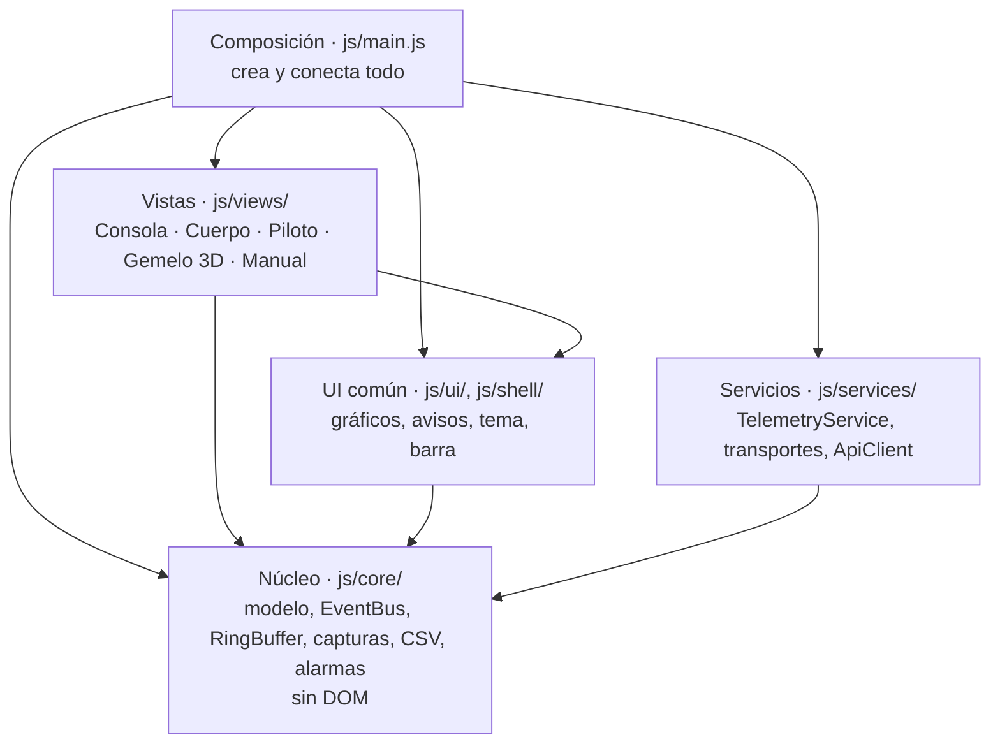
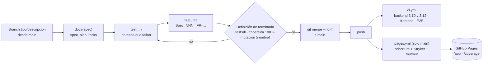

# Arquitectura

Diagramas del sistema, del más general al más particular (al estilo del
[modelo C4](https://c4model.com/)). Todos están en [Mermaid](https://mermaid.js.org/): GitHub los
dibuja solo y, como son texto, se revisan en el mismo diff que el código. El **porqué** de cada
pieza está en los [ADR](adr/README.md).

| Diagrama | Responde | Decisiones |
|---|---|---|
| [Contexto](#contexto) | ¿Quién usa el sistema y con qué sistemas externos habla? | — |
| [Contenedores](#contenedores) | ¿Qué piezas se ejecutan y por dónde se comunican? | [0010](adr/0010-el-backend-sirve-el-frontend.md), [0012](adr/0012-transporte-intercambiable.md) |
| [Despliegue](#despliegue) | ¿Dónde corre cada pieza? | [0007](adr/0007-reportes-en-github-pages.md), [0022](adr/0022-arranque-con-un-script-en-python.md) |
| [Componentes y una muestra](#componentes-y-recorrido-de-una-muestra) | ¿Qué hace cada módulo con un dato? | [0011](adr/0011-patrones-adapter-observer-facade.md), [0014](adr/0014-rendimiento-del-dibujo.md) |
| [Clases de los patrones](#clases-de-los-patrones) | ¿Cómo están armados Adapter, Observer, Facade, Strategy y Factory Method? | [0011](adr/0011-patrones-adapter-observer-facade.md), [0012](adr/0012-transporte-intercambiable.md), [0016](adr/0016-vistas-como-estrategias.md), [0019](adr/0019-fuente-de-datos-inyectada-y-cambio-en-caliente.md) |
| [Estados de la conexión](#estados-de-la-conexión) | ¿Qué muestra el indicador de conexión y qué lo cambia? | [0013](adr/0013-polling-encadenado-y-backoff.md) |
| [Cambio de fuente en caliente](#cambio-de-fuente-en-caliente) | ¿Cómo se pasa de la demo al robot sin quedar a ciegas? | [0019](adr/0019-fuente-de-datos-inyectada-y-cambio-en-caliente.md) |
| [Capas del cliente](#capas-del-cliente) | ¿Qué módulo puede depender de cuál? | [0015](adr/0015-nucleo-sin-dom.md) |
| [Entrega](#entrega-de-un-cambio) | ¿Qué le pasa a un cambio desde el branch hasta GitHub Pages? | [0003](adr/0003-historial-git-profesional.md), [0007](adr/0007-reportes-en-github-pages.md) |

---

## Contexto

El sistema **solo lee**: ninguna ruta de la API mueve al robot.

## Contenedores

El contrato entre frontend y backend es [`docs/API.md`](API.md).

## Despliegue

En GitHub Pages no hay backend: `/app/` usa `SimTransport`, el simulador del navegador, con la
misma interfaz que los transportes reales.

## Componentes y recorrido de una muestra

Los diagramas de componentes y de la secuencia de una muestra por WebSocket están en el README,
sección [Arquitectura](../README.md#-arquitectura).

## Clases de los patrones

Del lado del servidor:

## Estados de la conexión

Lo que muestra el indicador de conexión de la barra superior (`TelemetryService` publica
`connection` en el `EventBus`):

`setTransport()` vuelve a `connecting` con la nueva estrategia sin perder el historial.

## Cambio de fuente en caliente

## Capas del cliente

Las flechas son dependencias permitidas: nadie depende de una capa de arriba, y el núcleo no conoce
el navegador.

## Entrega de un cambio

