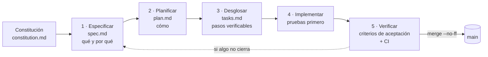

# Especificaciones (SDD · Spec-Driven Development)

Este proyecto se desarrolla con **Spec-Driven Development**: **ninguna línea de código se escribe
sin una especificación que diga *qué* hay que construir y *cómo se va a verificar***. La
especificación es la fuente de verdad. El código, las pruebas y la documentación se derivan de ella
y se pueden rastrear hasta ella.

> En SDD la especificación no es un documento que se escribe al final para "cumplir": es el
> **primer commit** de cada tarea. El código viene después y tiene que satisfacer los criterios de
> aceptación que la especificación ya fijó.

## El flujo



| Paso | Artefacto | Pregunta que responde | Quién lo lee |
|---|---|---|---|
| 0 · Principios | [`constitution.md`](constitution.md) | ¿Qué reglas no se negocian nunca? | Todos, siempre |
| 1 · Especificar | `NNN-nombre/spec.md` | ¿**Qué** necesita el usuario y **por qué**? ¿Cómo sabemos que está hecho? | Docente, equipo, usuario |
| 2 · Planificar | `NNN-nombre/plan.md` | ¿**Cómo** se construye? Archivos, decisiones, riesgos | Equipo |
| 3 · Desglosar | `NNN-nombre/tasks.md` | ¿En qué pasos chicos y verificables se divide? | Quien implementa |
| 4 · Implementar | código + pruebas | Cada commit referencia el requisito (`FR-…`) que cumple | Revisor |
| 5 · Verificar | CI + checklist | ¿Se cumplen **todos** los criterios de aceptación? | Revisor, docente |

## Cómo se trabaja una tarea (de punta a punta)

1. **Branch por tarea**, con un nombre que diga qué se hace (ver [`CONTRIBUTING.md`](../CONTRIBUTING.md)):
   `git switch -c fix/scroll-mobile`.
2. **Primer commit: la especificación.** Se copia [`_plantillas/`](_plantillas) a
   `specs/NNN-nombre/` y se completan `spec.md`, `plan.md` y `tasks.md`.
   Commit: `docs(spec): 006 scroll en el celular`.
3. **Pruebas que fallan** para cada criterio de aceptación (cuando es posible, antes del código).
4. **Implementación**, en commits chicos que citan el requisito: `fix(body): FR-002 la tabla de motores no atrapa el gesto`.
5. **Verificación**: `npm run test:all` en verde, cobertura 100 %, y se tildan los criterios en `tasks.md`.
6. **Merge sin fast-forward** a `main` (`git merge --no-ff`), para que en el historial quede
   visible el "paquete" de cada tarea. La especificación pasa a estado **Implementada**.

## Índice de especificaciones

Las especificaciones 001 a 005 documentan *a posteriori* lo que ya estaba construido antes de
adoptar SDD (se especificó el comportamiento existente y se lo enlazó con su código y sus
pruebas). Desde la 006 se escriben **antes** del código.

| N.º | Especificación | Estado | Origen |
|:-:|---|:-:|---|
| 001 | [Telemetría en tiempo real (API, WebSocket y polling)](001-telemetria-tiempo-real/spec.md) | ✅ Implementada | Retroactiva |
| 002 | [Los cuatro paneles de la consigna](002-paneles-consigna/spec.md) | ✅ Implementada | Retroactiva |
| 003 | [Captura de muestras y exportación CSV](003-captura-exportacion-csv/spec.md) | ✅ Implementada | Retroactiva |
| 004 | [Vistas múltiples y gemelo 3D](004-vistas-y-gemelo-3d/spec.md) | ✅ Implementada | Retroactiva |
| 005 | [Fuentes de datos intercambiables](005-fuentes-de-datos/spec.md) | ✅ Implementada | Retroactiva |
| 006 | [Desplazamiento en el celular](006-scroll-mobile/spec.md) | ✅ Implementada | `fix/scroll-mobile` |
| 007 | [Cobertura unitaria del 100 %](007-cobertura-100/spec.md) | ✅ Implementada | `test/vitest-cobertura`, `test/coverage-*` |
| 008 | [Pruebas de mutación](008-pruebas-de-mutacion/spec.md) | ✅ Implementada | `test/mutation-testing` |
| 009 | [Reportes de calidad en GitHub Pages](009-reportes-de-calidad/spec.md) | 🔄 En curso | `ci/pages-coverage` |
| 010 | [Errores hallados por las pruebas](010-errores-hallados-por-las-pruebas/spec.md) | ✅ Implementada | `fix/hallazgos-frontend`, `fix/hallazgos-backend` |
| 011 | [Decisiones de arquitectura (ADR) y diagramas](011-adr-y-diagramas/spec.md) | 🔄 En curso | `docs/adr-y-diagramas` |

Las especificaciones nuevas se agregan a esta tabla en el mismo commit que las crea.

## Trazabilidad

Cada requisito tiene un identificador estable (`FR-001`, `NFR-002`, `SC-003`) que aparece en:

- la especificación (`spec.md`), donde se define;
- las tareas (`tasks.md`), donde se planifica;
- los mensajes de commit, donde se implementa;
- el nombre o la descripción de la prueba que lo verifica, cuando corresponde.

Así, desde cualquier línea del historial de git se puede volver a *por qué* existe.

## Estructura de la carpeta

```
specs/
├── README.md               ← este archivo: el proceso y el índice
├── constitution.md         ← principios no negociables del proyecto
├── _plantillas/            ← plantillas de spec, plan y tasks
└── NNN-nombre-corto/
    ├── spec.md             ← qué y por qué (sin detalles de implementación)
    ├── plan.md             ← cómo (arquitectura, archivos, decisiones)
    └── tasks.md            ← pasos verificables, tildados al terminar
```
